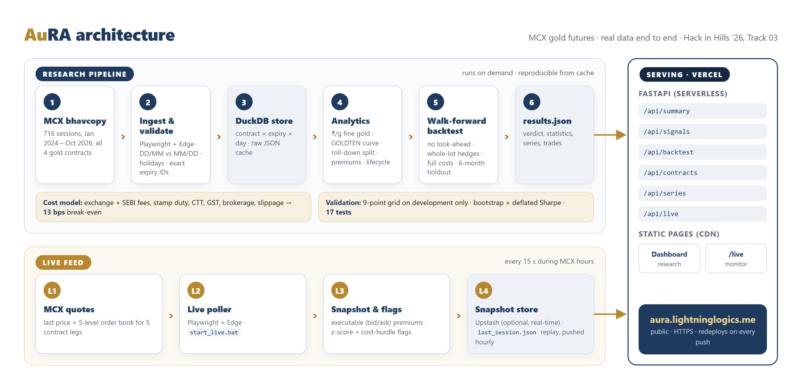

# AuRA: Aurum Relative-value Analytics

**Do MCX's four gold futures price the same gold the same way, and can anyone profit when they don't?**

Team **Lightning Logics** · Hack in Hills '26 · Track 03: Commodity Derivatives Intelligence

- **Live dashboard:** https://aura.lightninglogics.me
- **Live MCX monitor:** https://aura.lightninglogics.me/live
- **Demo video (2 min):** https://youtu.be/29peqQnTcX8

---

## In 30 seconds

- We pulled **716 trading sessions of real MCX data** (Jan 2024 – Oct 2026) for GOLDM, GOLDTEN, GOLDGUINEA and GOLDPETAL.
- After converting every contract to **₹ per gram of fine gold**, small lots trade at a **standing premium**: GOLDPETAL sits a median **+69 bps** above GOLDTEN for the same delivery date.
- A walk-forward strategy trading the gaps made money in development, but **lost 1.4 bps per trade after costs on an untouched 6-month holdout**.
- **Verdict: no persistent edge survives execution costs.** Track 03 explicitly accepts a rigorous no-edge proof as a valid result, and this is one.

---

## 1. The problem

MCX lists four gold futures on the same metal:

| Contract | Lot | Price quoted per | Purity | Expiry |
|---|---|---|---|---|
| GOLDM | 100 g | 10 g | 995 | 3rd–5th of the month |
| GOLDTEN | 10 g | 10 g | 999 | 27th–31st |
| GOLDGUINEA | 8 g | 8 g | 999 | 27th–31st |
| GOLDPETAL | 1 g | 1 g | 999 | 27th–31st |

Raw prices can't be compared: lot size, quote unit, purity and expiry all differ. Once they're
normalised, the prices should agree. **AuRA measures where they don't, explains why, and tests
whether the gap is tradeable after real costs.**

## 2. How AuRA works

1. **Normalise:** `₹/g fine = price ÷ quote grams ÷ purity`, so every contract is like for like.
2. **Compare same delivery dates:** the premium of PETAL and GUINEA over GOLDTEN for the *same expiry*, so carry cancels out.
3. **Handle carry honestly:** GOLDM expires on different dates, so it is compared with the GOLDTEN futures curve read at GOLDM's expiry. This separates mechanical roll-down from genuine dislocation.
4. **Signal:** a z-score of each premium against its own trailing history (past data only).
5. **Test it like real money:** a walk-forward backtest with no look-ahead (decide at today's close, trade at tomorrow's), whole-lot hedges holding equal grams of gold (100 PETAL vs 10 GOLDTEN), P&L on the contracts actually held, and every cost:

   | Cost (per leg, per side) | Rate |
   |---|---|
   | MCX transaction fee | 0.0021% |
   | SEBI turnover fee | 0.0001% |
   | Stamp duty (buy) | 0.002% |
   | Commodity transaction tax (sell) | 0.01% |
   | GST | 18% on fees and brokerage |
   | Brokerage (assumed) | ₹20 per order |
   | Slippage (assumed) | 1.5 bps GOLDTEN, 3 bps PETAL / GUINEA |

   Together these make a **13 bps break-even** for each round trip.
6. **Validate:** parameters are picked from a 9-point grid on the development period only. The final 6 months stay untouched until the last test. We report a block-bootstrap p-value and the deflated Sharpe ratio, which corrects for having tried 9 settings.

## 3. Results

**PETAL vs GOLDTEN, net of every cost**

| | Development (Apr 2025 – Apr 2026) | **Holdout (Apr – Oct 2026, untouched)** |
|---|---|---|
| Trades | 14 | **7** |
| Net bps per trade | +22.1 | **−1.4** |
| Net bps, excluding the best trade | +7.6 | **−3.7** |
| Sharpe (annualised) | 0.92 | **−0.45** |
| Bootstrap p-value | 0.12 | **0.76** |
| Deflated Sharpe probability | 0.74 | **0.38** |

**Why the development profit was an illusion:** 78% of it came from one exit at the
**30 Jan 2026 close**, a gold sell-off day when contracts closed at inconsistent prices nobody
could actually trade. Without that trade the development edge is +7.6 bps, and on the holdout
it turns negative. GUINEA vs GOLDTEN traded too rarely to judge: 4 trades in development, none
in the holdout.

**What the data does show**

- **Small lots carry a standing premium, not a mispricing.** PETAL: median +69 bps over GOLDTEN, never below +11 bps. GUINEA: median +51 bps.
- **The carry trap is real.** GOLDM looks 24.6 bps *cheap* on a naive comparison. After purity it is +15.5 bps, and after carry +6.7 bps (medians over 395 sessions).
- **Carry vs genuine moves.** The GOLDTEN curve implies about 9.7% a year carry. Mechanical roll-down explains only about 4% of a typical day's price move.
- **Contract lifecycle.** A new contract takes a median 58 sessions (PETAL, GUINEA), 68 (GOLDTEN) or 37 (GOLDM) to become the liquid one.

## 4. Live monitor

[`/live`](https://aura.lightninglogics.me/live) reads MCX's quote feed, including the
**5-level order book**, every 15 seconds and shows:

- **Last-trade and executable premiums.** The executable premium is what you would actually get selling the small lot at the bid and buying GOLDTEN at the ask.
- **Flags only when they matter:** a pair is flagged only if it is statistically unusual **and** the executable gap clears the 13 bps cost hurdle. Every card says why it is, or isn't, flagged.
- The day's premium chart, plus bid, ask, spread, volume and open interest for every leg.

MCX serves its data only to real browsers, so the feed runs from a machine with Microsoft
Edge (`start_live.bat`) during MCX hours. When no feed is running, the page replays **the
last real session**, labelled as a replay, never stale or invented numbers.

## 5. How each Track 03 requirement is met

| Track 03 asks for | Where |
|---|---|
| Relative value: normalise size, quote unit, purity (995 vs 999) | `aura/specs.py`, `analytics.panel` |
| Term structure: model the curve, split roll-down from genuine shifts | `analytics.curve_at`, `analytics.roll_down_split` |
| Day-by-day walk-forward, no look-ahead, slippage and liquidity | `aura/backtest.py`; test `test_future_data_cannot_change_past_trades` |
| Trader-facing intelligence: suppress noise, separate edge from gold-price moves | dashboard and `/live` (z-score + cost hurdle); gold beta and correlation per backtest |
| Contract lifecycle: listing, liquidity build-up, delivery window, expiry | `analytics.lifecycle`, dashboard table |
| Validated on unseen data, net of costs, on held contracts | untouched 6-month holdout; P&L marked on the expiry actually held |
| **Data traps:** DD/MM requests vs MM/DD responses; holidays; exact expiry IDs; settlement ≠ fill; GOLDTEN's short history | `aura/ingest.py` (all handled, with tests); untraded rows dropped; TEN pairs start Apr 2025 |

## 6. Architecture



**Stack:** Python 3.12 · Playwright (Edge) · DuckDB · pandas / NumPy · FastAPI · Plotly · Vercel

| API endpoint | Returns |
|---|---|
| `/api/summary` | data coverage, premium statistics, carry, roll-down split, cost hurdle, verdict |
| `/api/signals` | latest reading per pair and why it is or isn't flagged |
| `/api/backtest` | development and holdout results, every trade |
| `/api/contracts` | lifecycle of every contract |
| `/api/series` | daily series behind the charts |
| `/api/live` | latest live snapshot and the day's ticks |

## 7. Run it yourself

```bash
python -m venv .venv
.venv/Scripts/python -m pip install -r requirements-dev.txt   # macOS/Linux: .venv/bin/python
.venv/Scripts/python -m aura.ingest --start 2024-01-01         # pull MCX history into data/
.venv/Scripts/python -m aura.report                            # run the analysis -> data/results.json
.venv/Scripts/python -m uvicorn aura.api:app --port 8000       # dashboard at http://localhost:8000
.venv/Scripts/python -m aura.live                              # optional: live feed (MCX hours)
.venv/Scripts/python -m pytest -q                              # 17 tests
```

Every raw MCX response is cached in `data/raw/`, so results are reproducible and re-runs never
fetch a day twice.

```
aura/        specs (contract mechanics) · ingest · analytics · backtest · stats · report · live · api
api/         Vercel entry point
public/      dashboard (index.html) and live monitor (live.html)
data/        results.json and last_session.json (committed); raw cache (not committed)
tests/       units, date parsing, costs, no look-ahead, live flag rules, API fallbacks
```

## 8. Limitations

- **Backtest fills** use the daily close plus assumed slippage; intraday order-book history isn't public. The live monitor does use the real bid/ask.
- **Brokerage and slippage are assumptions.** Statutory rates should be checked against a broker contract note.
- **Short history:** GOLDTEN listed in April 2025, so the holdout has only 7 trades. That's why the bootstrap and deflated Sharpe are reported alongside the raw numbers.
- **The live feed needs a machine running the poller.** A production version would use a licensed broker data feed for 24/7 coverage.

## Team Lightning Logics

| Member | Role |
|---|---|
| R S Surjune | Team lead, quant and backend |
| Abhinandana B | Market research and modelling |
| Nithiesh Karthick | Frontend and visualisation |
